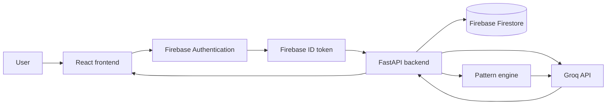

# Mitra — Frontend

The React frontend for **Mitra**, an adaptive conversational companion. It provides account sign-in, a chat interface, mode-aware conversations and message feedback, and communicates with the Mitra FastAPI backend.

<div align="center">

[](https://mitra-frontend-ivory.vercel.app/)
[](https://react.dev/)
[](https://firebase.google.com/)
[](https://tailwindcss.com/)

</div>

## Overview

Mitra is designed to adapt its conversational style to the user's messages. The interface supports three response modes:

- **Friend** — warm, conversational responses.
- **Guide** — structured, practical guidance.
- **Therapist** — reflective, empathetic responses.

The backend determines the mode when automatic mode is selected. These labels describe response styles, not professional or clinical services.

## Features

- Sign in and sign up with Google or email/password using Firebase Authentication.
- Chat interface with a sidebar and session-aware conversations.
- Automatic mode selection or a selected conversation mode.
- Display the mode used for each assistant response.
- Submit thumbs-up or thumbs-down feedback on assistant messages.
- Obtain a Firebase ID token for the signed-in user and send it to the backend as a Bearer token.
- Configure the backend URL through an environment variable.

## Architecture



Repositories:

- **Frontend:** [mitra-frontend](https://github.com/ManojKumarBhagavatula/mitra-frontend)
- **Backend:** [mitra-backend](https://github.com/ManojKumarBhagavatula/mitra-backend)

## Tech Stack

| Area | Technology |
|---|---|
| UI | React 18 |
| Styling | Tailwind CSS |
| Authentication | Firebase Authentication |
| HTTP requests | Axios |
| API | FastAPI backend |

## Run Locally

### Prerequisites

- Node.js and npm
- A Firebase project with a Web App registered
- The Mitra backend running locally or deployed

### 1. Clone and install

```bash
git clone https://github.com/ManojKumarBhagavatula/mitra-frontend.git
cd mitra-frontend
npm install
```

### 2. Configure Firebase

In the Firebase Console:

1. Create or select your Firebase project.
2. Register a Web App and copy its Firebase configuration.
3. Enable **Google** and **Email/Password** under Authentication → Sign-in method.
4. Confirm the deployed frontend domain is listed under Authentication → Settings → Authorized domains.
5. Update the configuration values in `src/firebase.js`.

Firebase web configuration is designed to be included in client applications; it is not a substitute for access control. Protect the project with appropriate Authentication settings and authorized domains. Never place service-account credentials or private server API keys in frontend code.

### 3. Configure the backend URL

Copy the example environment file:

```bash
cp .env.example .env.local
```

Set the backend URL in `.env.local`:

```env
REACT_APP_API_URL=http://localhost:8000
```

For a deployed frontend, set `REACT_APP_API_URL` to the deployed FastAPI backend URL in your hosting provider's environment settings.

### 4. Start the development server

```bash
npm start
```

The React development server runs at [http://localhost:3000](http://localhost:3000).

### 5. Create a production build

```bash
npm run build
```

## How API Authentication Works

The user signs in through Firebase Authentication. Before each protected API request, the frontend calls `auth.currentUser.getIdToken()` and sends the result in the HTTP header:

```http
Authorization: Bearer <Firebase_ID_Token>
```

The backend verifies this token with Firebase Admin SDK and checks that the requested chat session belongs to the authenticated Firebase user. The frontend does not send or store the Firebase service-account key.

## Deployment

The frontend can be deployed to Vercel:

1. Import this GitHub repository into Vercel.
2. Set `REACT_APP_API_URL` to the deployed FastAPI backend URL.
3. Add the production frontend domain to Firebase Authentication's authorized domains.
4. In the backend Render service, set `FRONTEND_ORIGIN` to the exact frontend origin (for example, `https://mitra-frontend-ivory.vercel.app`).
5. Deploy the frontend and backend.

If you use a different Vercel domain, update the backend's `FRONTEND_ORIGIN` environment variable to match it exactly. CORS does not replace API authentication.

See the [Vercel documentation](https://vercel.com/docs) for framework and deployment settings.

## Related Links

- [Live application](https://mitra-frontend-ivory.vercel.app/)
- [Backend repository and API setup](https://github.com/ManojKumarBhagavatula/mitra-backend)
- [Firebase documentation](https://firebase.google.com/docs)
- [React documentation](https://react.dev/)

---

<div align="center">

Part of the **Mitra Adaptive Companion Chatbot** project.

</div>
